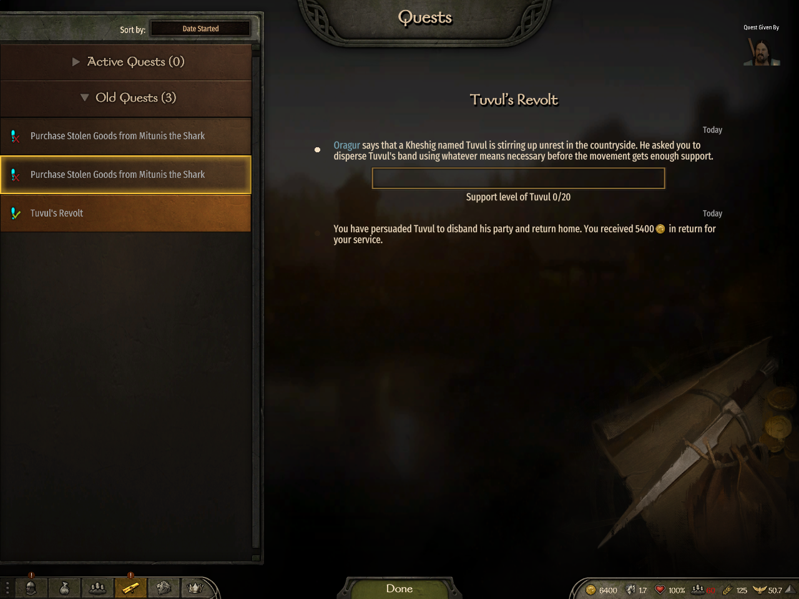
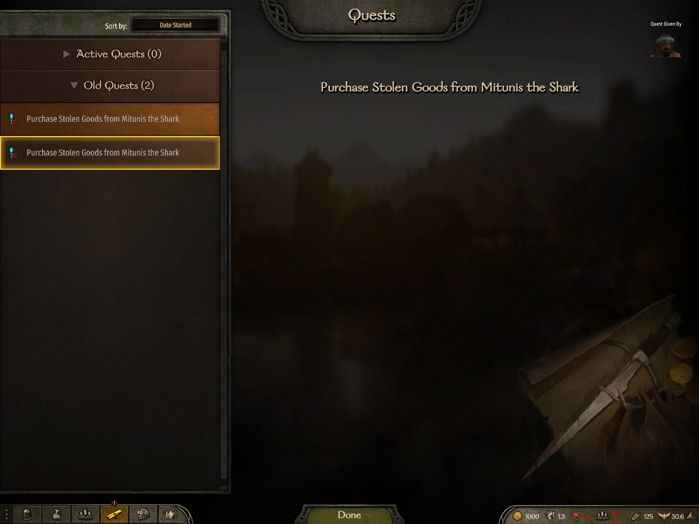
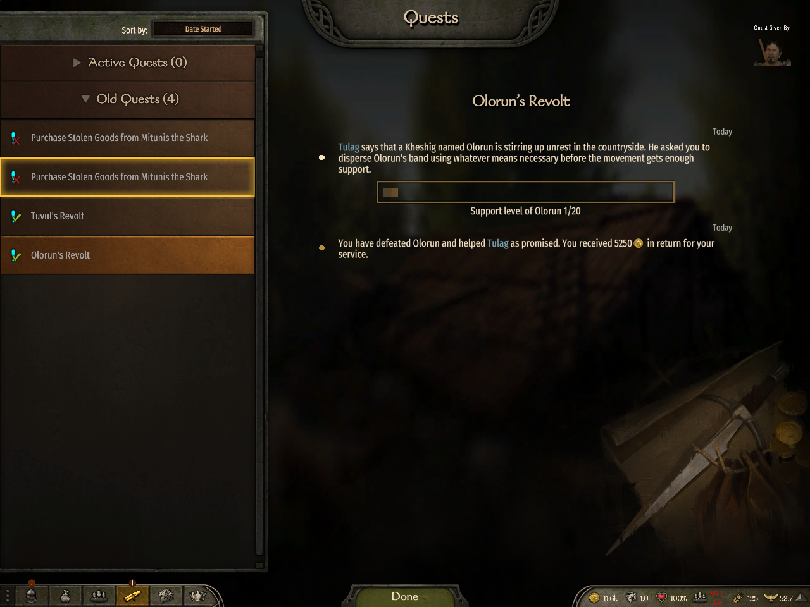
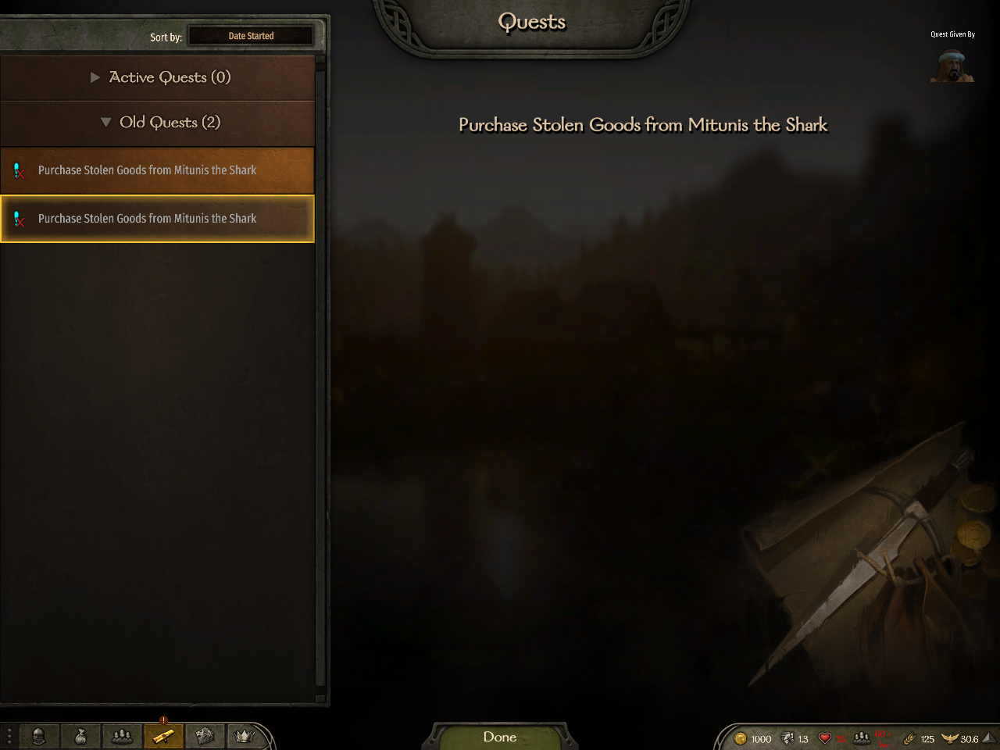
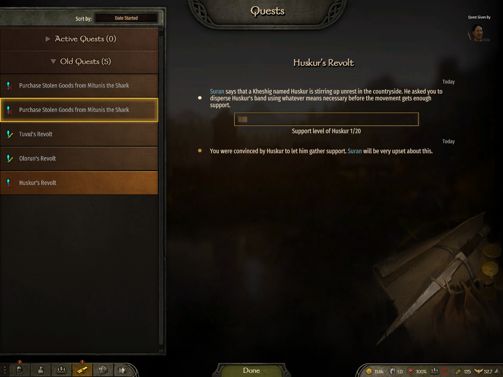
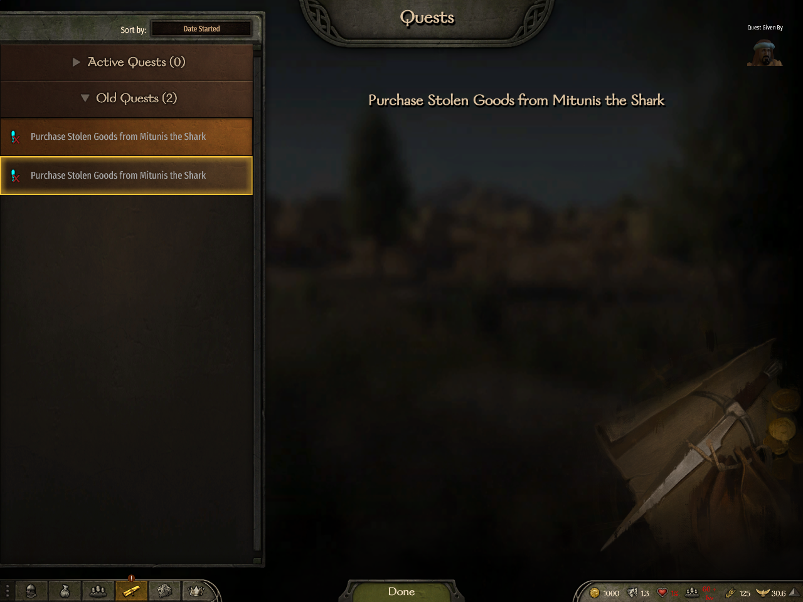

Oragur visibly offers 5,400 gold and the player can choose 'I'll find them and put a stop to what they're doing.' Gold is 1,000. This is the offer before acceptance.

Tested `6e268638332dc9c89111b04aea9640b67f6e8ec6`; SHA256 `ca8d69bd73f330f3ce890ea72c7a8a7a779c037dd6481c510d21205c90a7bd48`.

Observer A on the Quyaz map, gold 1,000. Pre-ending context only. Associated strict receipts establish B owns an active quest and A has no quest; those states are not visible in this image.

Tested `6e268638332dc9c89111b04aea9640b67f6e8ec6`; SHA256 `41c0a1e717c9e56040eb8ea563b88093fffcc2e8543a51470540758279312ec8`.

Owner B in the Ortongard town menu, gold 1,000. Pre-ending context only. The accepted, active quest is receipt-backed; neither a quest nor its journal is visible here.

Tested `6e268638332dc9c89111b04aea9640b67f6e8ec6`; SHA256 `7cc1a94af901aefa8bdf0a4d70a4000f11d9db3322a6d65e2431c3a9dfc2b48d`.

FailureByBattle (R4): Owner B: Old Quests 3 and Tuvul's Revolt failed, with its opening and full battle-loss ending each once. The other seed row stays highlighted while the details show Tuvul.

Tested `6e268638332dc9c89111b04aea9640b67f6e8ec6`; SHA256 `9dcf196524084017652c9498050288f0111d472bf0bbfabd524d89b1d4f4d300`.

FailureByBattle (R4): Observer A: Active Quests 0, Old Quests 2, only existing Mitunis seed entries. No Tuvul entry. The specific journal lookup also returned no matching native entry.

Tested `6e268638332dc9c89111b04aea9640b67f6e8ec6`; SHA256 `19708bc3cb20f55a56b335251a12d2459d9fc9a14aa2b6298ea4efe1f4fc29bb`.

SuccessByAgreement: owner B: Old Quests 3, Tuvul's Revolt succeeded; opening and persuaded-disband ending with 5,400 gold each once.

Tested `bd74a2d5323edd542faebc14b4b9802e6db81184`; SHA256 `810ba6e482e89ac03f97a2543e3163ab0847f0a2a252ddaf51a4a810db4e50e0`.

SuccessByAgreement: observer A: Active Quests 0, Old Quests 2, only seed entries; no matching revolt entry.

Tested `bd74a2d5323edd542faebc14b4b9802e6db81184`; SHA256 `a58362e17616ee90d17d7b026081aaa5b5b1cba2480e8b8bf5dbaf2a35a6067e`.

SuccessByBattle: owner B: Old Quests 4, Olorun's Revolt succeeded; opening and defeated ending with 5,250 gold each once. Prior Tuvul success remains.

Tested `bd74a2d5323edd542faebc14b4b9802e6db81184`; SHA256 `3f5bfa91b8e605384abc64ef442d87dac5892d9cfd96b190e915cdd69b36cbd5`.

SuccessByBattle: observer A: Active Quests 0, Old Quests 2, only seed entries; no matching revolt entry.

Tested `bd74a2d5323edd542faebc14b4b9802e6db81184`; SHA256 `a5308795b09890f2879699a8e8071787bbfab4dd826b703b4b8b52c6521d5426`.

FailureByRelease: owner B: Old Quests 5, Huskur's Revolt failed; opening and convinced-let-gather-support ending each once. Both earlier successes remain.

Tested `bd74a2d5323edd542faebc14b4b9802e6db81184`; SHA256 `7b1cc8107bdaae6e7b33f60b6f6fb3e9dd47d7e20a5a2fe3f6895b512f53a280`.

FailureByRelease: observer A: Active Quests 0, Old Quests 2, only seed entries; no matching revolt entry.

Tested `bd74a2d5323edd542faebc14b4b9802e6db81184`; SHA256 `0fcad0b17a793ff9a6566786e827630e724257eb3c1a432a37fb798bbc0bff29`.
