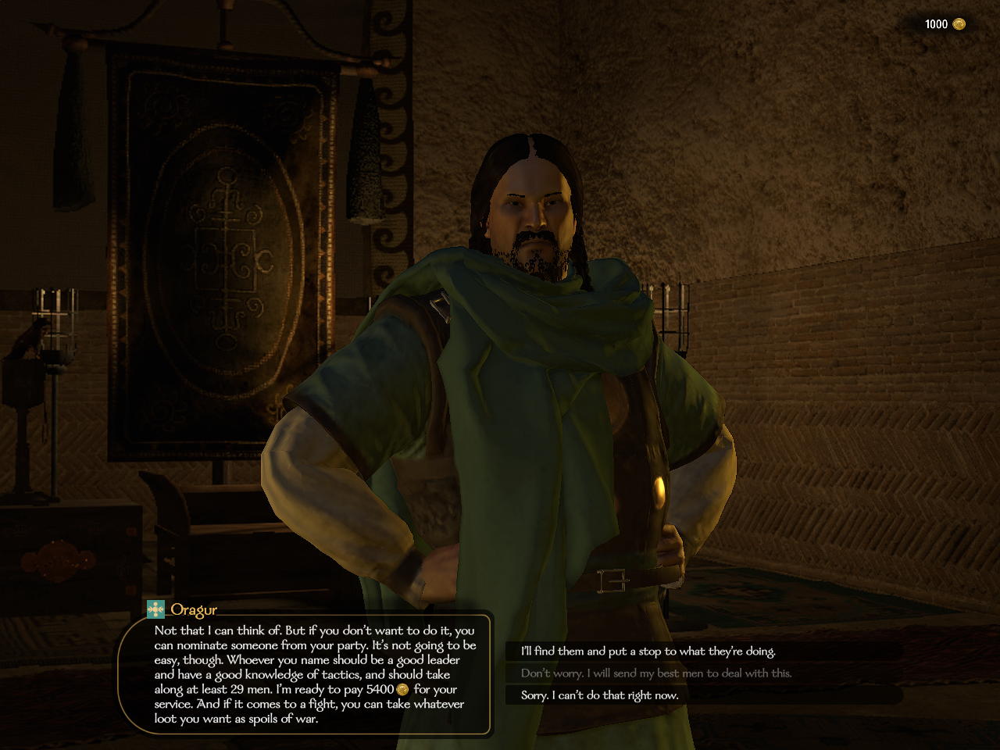
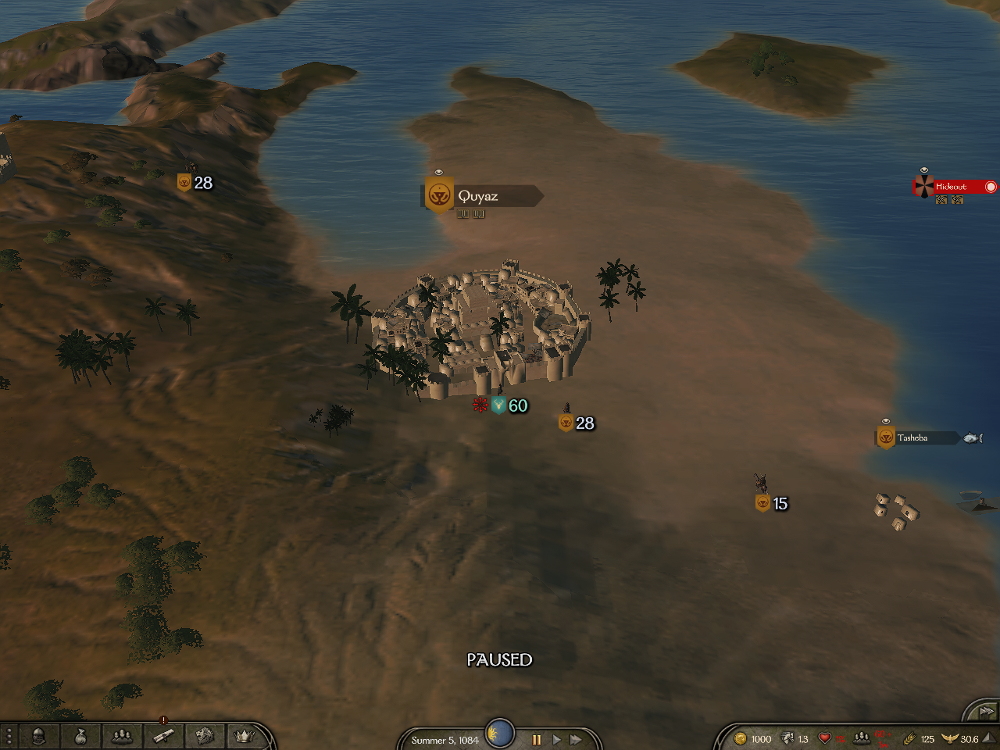
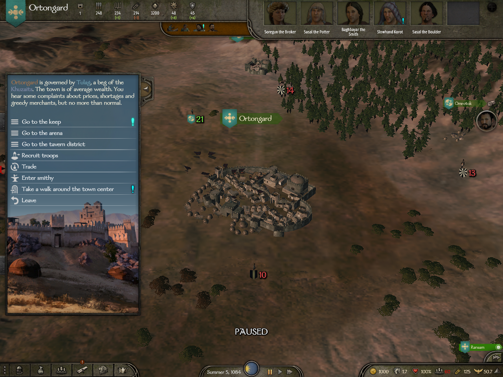
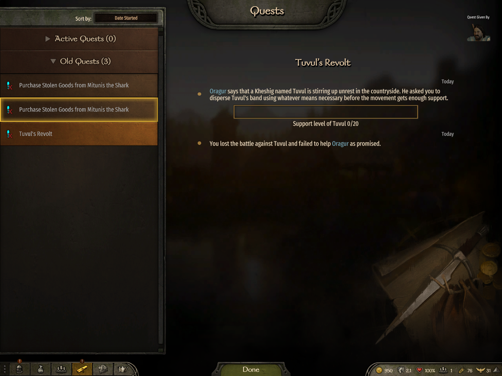
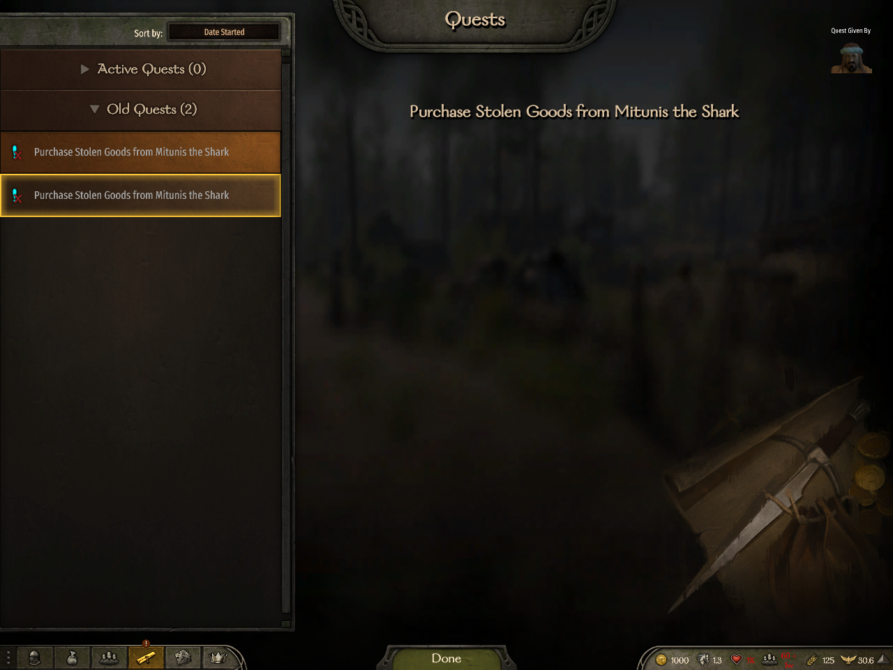

Oragur visibly offers 5,400 gold and the player can choose 'I'll find them and put a stop to what they're doing.' Gold is 1,000. This is the offer before acceptance.

SHA256 `ca8d69bd73f330f3ce890ea72c7a8a7a779c037dd6481c510d21205c90a7bd48`.

Observer A on the Quyaz map, gold 1,000. Pre-ending context only. Associated strict receipts establish B owns an active quest and A has no quest; those states are not visible in this image.

SHA256 `41c0a1e717c9e56040eb8ea563b88093fffcc2e8543a51470540758279312ec8`.

Owner B in the Ortongard town menu, gold 1,000. Pre-ending context only. The accepted, active quest is receipt-backed; neither a quest nor its journal is visible here.

SHA256 `7cc1a94af901aefa8bdf0a4d70a4000f11d9db3322a6d65e2431c3a9dfc2b48d`.

Owner B: Old Quests 3 and Tuvul's Revolt failed, with its opening and full battle-loss ending each once. The other seed row stays highlighted while the details show Tuvul.

SHA256 `9dcf196524084017652c9498050288f0111d472bf0bbfabd524d89b1d4f4d300`.

Observer A: Active Quests 0, Old Quests 2, only existing Mitunis seed entries. No Tuvul entry. The specific journal lookup also returned no matching native entry.

SHA256 `19708bc3cb20f55a56b335251a12d2459d9fc9a14aa2b6298ea4efe1f4fc29bb`.
