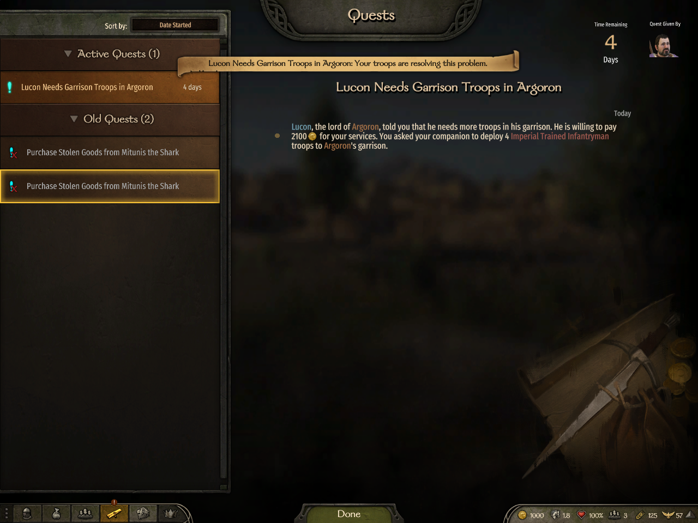
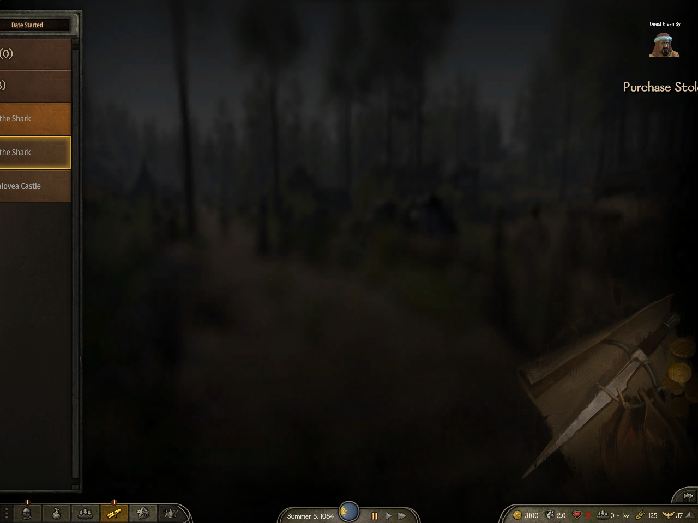
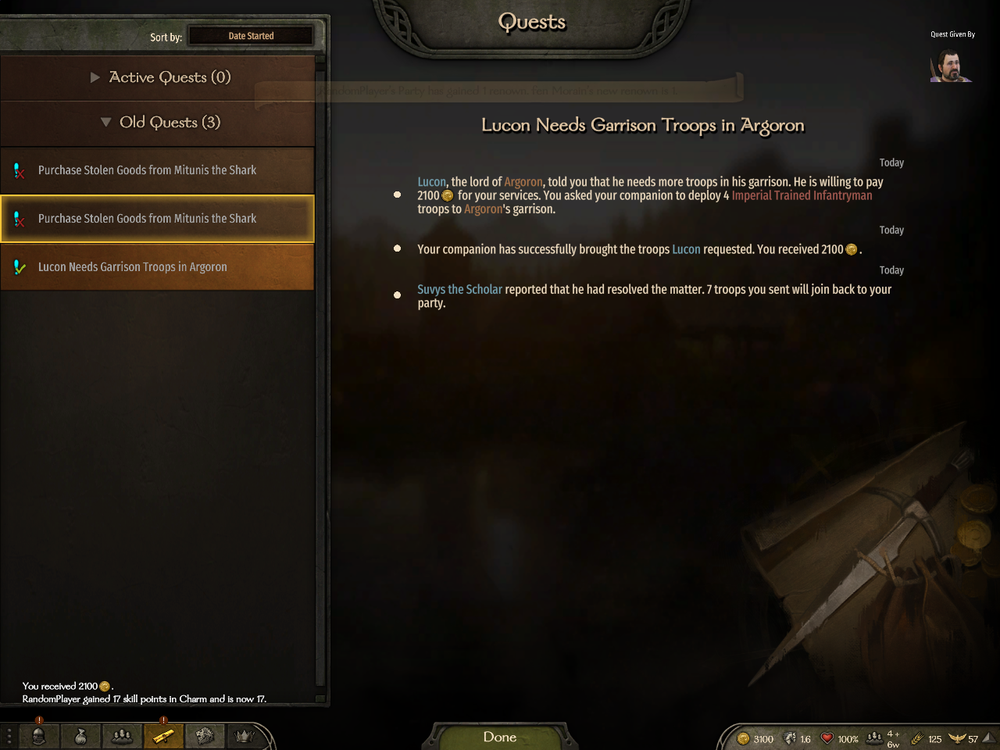
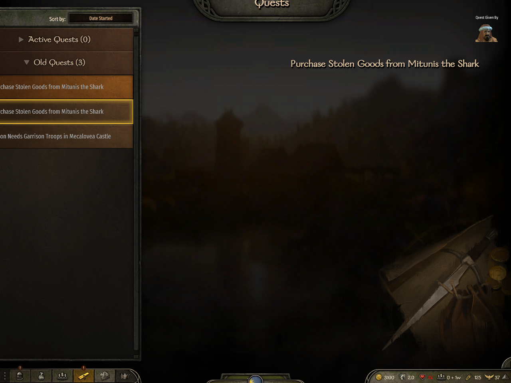
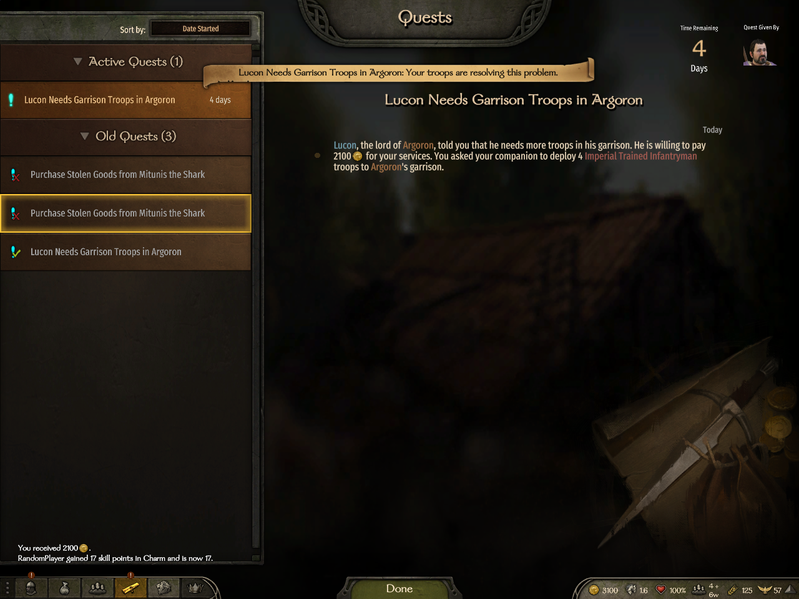
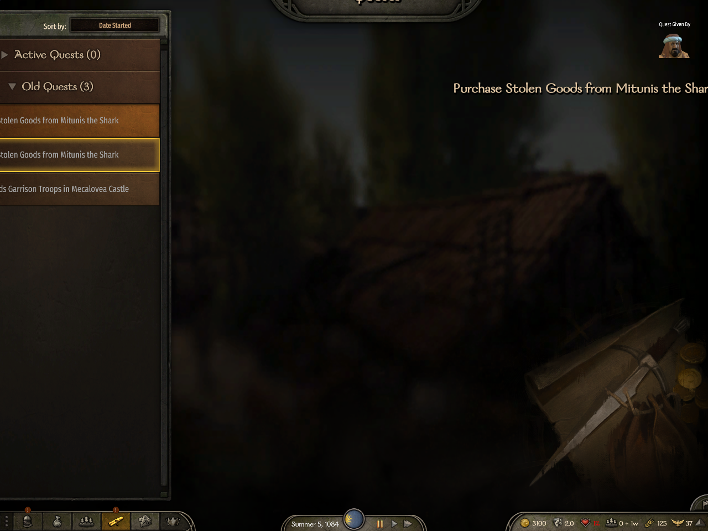
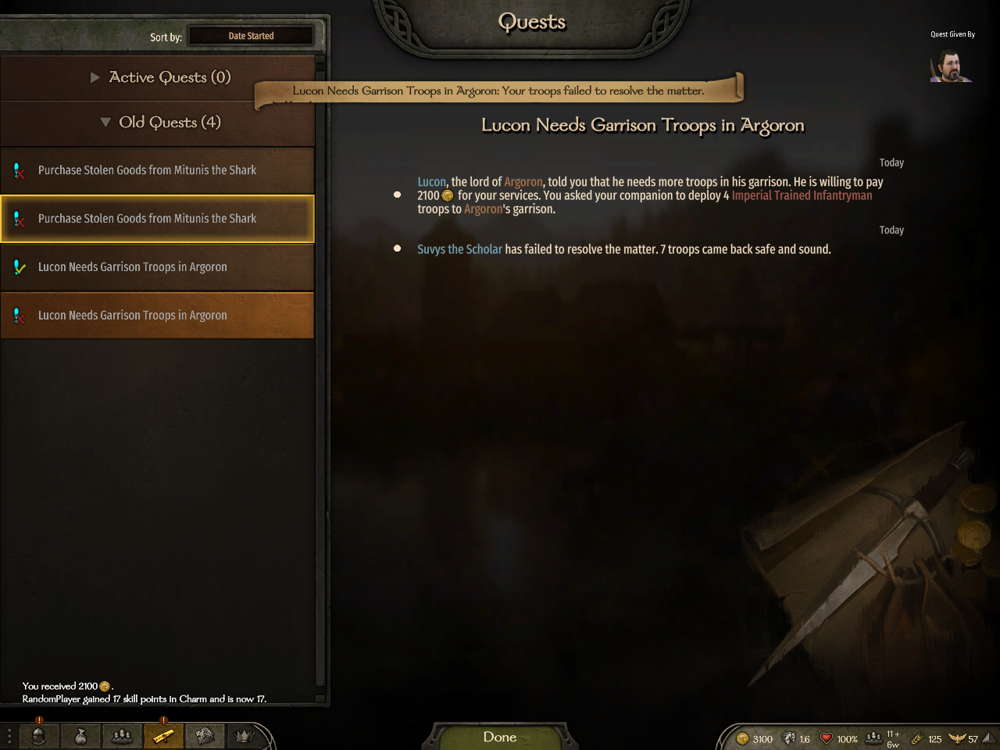
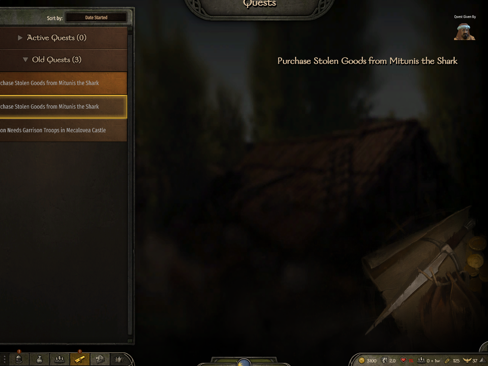

# Companion mission journal evidence for #4080

## What the issue is

Companion missions could finish without completing the owner’s journal. The final success or failure text must reach that player before the issue is detached.

## What the evidence shows

Lucon’s Argoron mission immediately appears in its owner’s Old Quests with all three native success stages, or both native failure stages. The other player receives neither archive.

Tested source is #3957 carrier `7c5c5604be96810bff09fbc39e44ccaf0032f3fd`, not an own-head live run of #4080. All five #4080 additions, including the three production files, and the complete Framework tree are byte-identical to #4080 at `5fd677c836ebae89bdc86b6c5ad05610546dfd4c`; the carrier adds only eight garrison files. See [source comparison](source-equivalence.json), [scope and limits](README.md), and [image hashes](manifest.json).

## Native success, before and after

Owner: `testclient2`. Observer: `testclient`. The owner sends Suvys the Scholar to Lucon’s Argoron mission, then receives the completed three-stage journal, including the 2,100-denar success and Suvys’s return report. Server and owner archive `issue_171` matched exactly; the observer had no related archive.

_Before return, the owner has one active Argoron companion mission._

_Before return, the observer has no active Argoron companion mission._

_After success, the owner sees all three stages and Suvys the Scholar’s return report._

_After success, the observer retains only their own three old quests._

## Native failure, before and after

A second Argoron mission ends with the failed status and both native stages. The final text reads “Suvys the Scholar has failed to resolve the matter. 7 troops came back safe and sound.” Server and owner archive `issue_172` matched exactly; the observer had no related archive.

_Before failure, the owner has a new active Argoron mission beside the earlier success._

_Before failure, the observer’s journal still contains only their own old quests._

_After failure, the owner sees both stages and the seven-troop return report._

_After failure, the observer receives no Argoron failure archive._

## Accepted scope

Carrier job `live-3784-rl-7bb576ab3d29` passed 160/160 steps. Native archive snapshots/comparisons/observer checks are steps 108/109/111 and 154/155/157. Related job `live-3784-rl-d71675e19859` passed 102/102 for independent concurrent owners and accelerated native timeout. The parent independently accepted both exact native ending journals, observer absence, all 46 screenshots through eight sheets plus full owner originals, and 1,193 hashed CI/live manifest files. Both jobs were collected, processes were verified absent and saves restored; the first stop race was followed by verified absence.

This is generic framework proof through the garrison carrier only. Other registered quests, rejoin, detailed returned troop identity/wounds/XP and natural 30-day expiry are not live-proven here. Carrier client-authority diagnostics remain unresolved and are not dismissed by the passing assertions. Parent owns the remaining #3957 flows and its garrison conformance findings.

The user accepts this Markdown publication because the canonical HTML renderer requires an unretained campaign-ready batch receipt. No receipt was fabricated and no alternate exporter was used. The eight approved PNGs retain their original bytes. Raw logs, credentials and save files are excluded.
