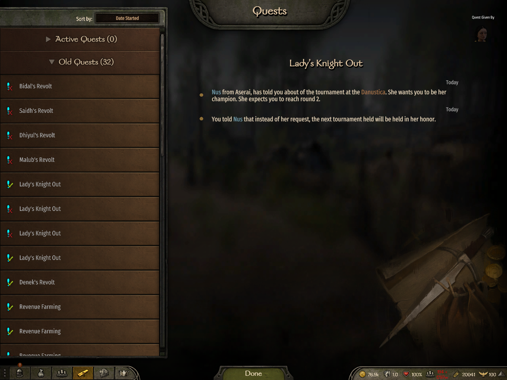
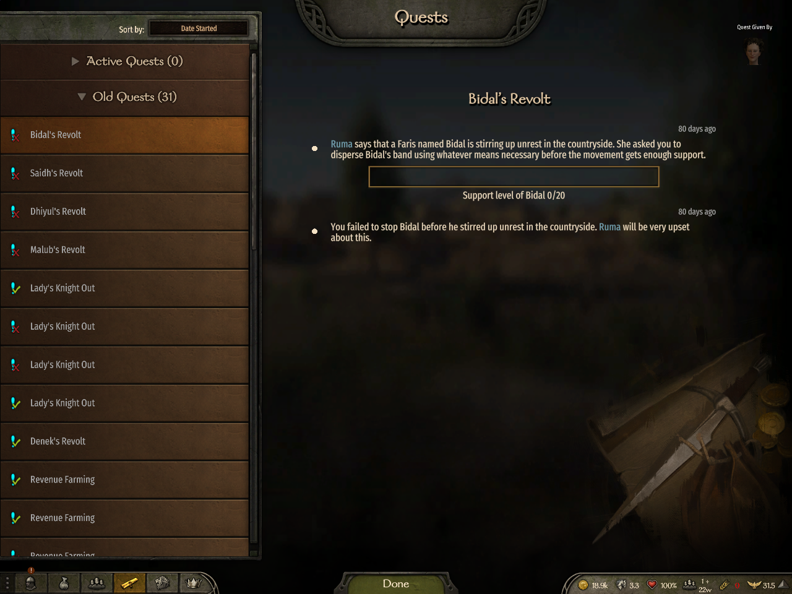

# Pending influence solution, B joins before completion

PASS on 9e4a7c6af488ae5464339f384a8b7ca2215695f2, tree f1b89f065e82f095d5105de05a8ab6e06116495b. Local run issue3781-20261022T041140, native Bannerlord v1.4.8, private desktop. A/testclient116740, B/testclient2 102396, dedicated engine83484, launcher45760. No foreground input; launcher guard recorded0 activations.

Nus (Hero_CharacterObject_2704) was in Danustica/town_ES1, security40. The existing server debug commands set eligibility and influence100 before reward baselines. A chose the real influence dialogue for issue_1154. Server and A showed SolvingWithLordSolution, owner testclient, tried=True, one acceptance log, influence100. A kept the conversation open throughout B's full save download/load and campaign entry. B reached readyForCampaignTests=True and loaded the same pending issue with owner testclient and tried=False. A still had tried=True and an open conversation. Rewards were unchanged at this point.

A chose the real leave option and continued out of conversation. The normal menu/completion path finalized the issue; a server move into Danustica was also issued. No claim is made that the move alone caused completion. All endpoints then had no attached Nus issue and0 started Lady quests.

| Observed value | Before completion | After completion |
| --- | --- | --- |
| A gold | 76908 | 76908 |
| A renown | 1183.5103 | 1190.5103 |
| A influence | 100 | 82 |
| A effective relation with giver | 0 | 5 |
| B gold | 18955 | 18955 |
| B renown | 542.8492 | 542.8492 |
| B influence | -50 | -50 |
| B effective relation with giver | -14 | -14 |
| B Honor level / local XP | 0 / 0 | 0 / 0 |

Server and both clients agreed on replicated player values. A's Nus journal entry ended=True with2 messages. Server's corresponding raw entry remained ended=False with2 messages. B's raw save-loaded entry remained ended=False with only its acceptance message; it had no completed Nus entry. Raw journals and reward reads support these claims; reward values are not asserted visible in the journal images.

_InfluenceSolution owner A: Nus's completed native journal has both messages after B joined while the solution was pending. Active Quests0, Old Quests32._

_InfluenceSolution non-owner B: native journal after joining during the pending solution and A completing. Active Quests0, Old Quests31; no new Nus completion. Existing historical Lady entries remain visible. Giver-specific archive reads establish the absence of a completed Nus entry._

Screenshots captured04:38:37Z/04:38:39Z and visually inspected. Cleanup completed04:39:33Z with verifiedAbsent=True; bench released and confirmed free before publication.

Coverage: this live run proves snapshot-before-completion after a real pending-issue save load. The focused E2E theory covers both snapshot-before-completion and queued-completion-before-snapshot, with a sensitive red witness and final-head green46/46 Lady+3/3 layout tests. Three final-head source reviews are CLEAN. Final queue run docker-ci-7ff351b2fb274365851c passed all unit suites and E2E discovery, but its runner rejected DLL filtered execution before any E2E test ran. Broad GitHub checks remain required. Shared tournament archive filtering and owner completed-history persistence across reload are outside this correction.