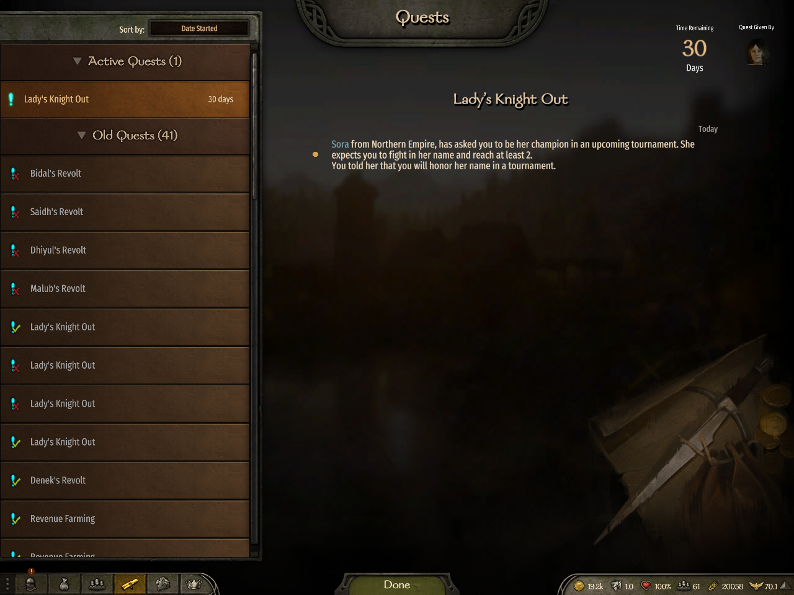
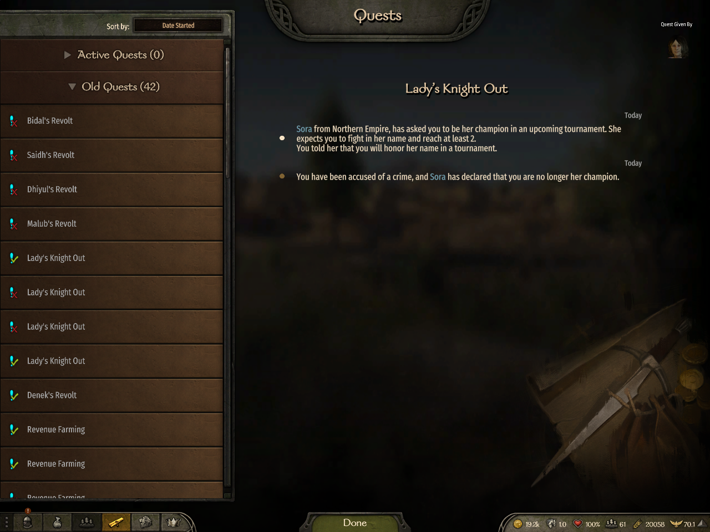
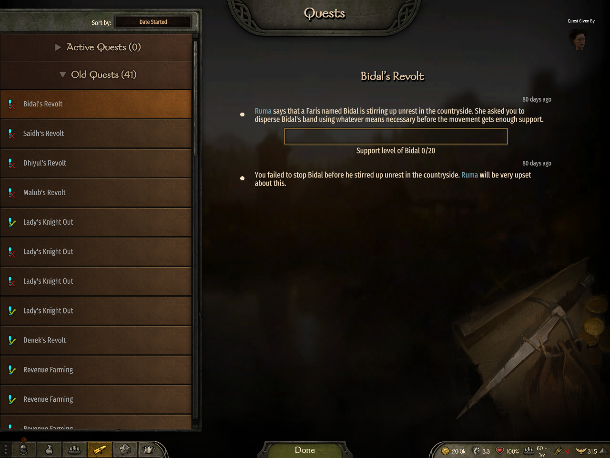
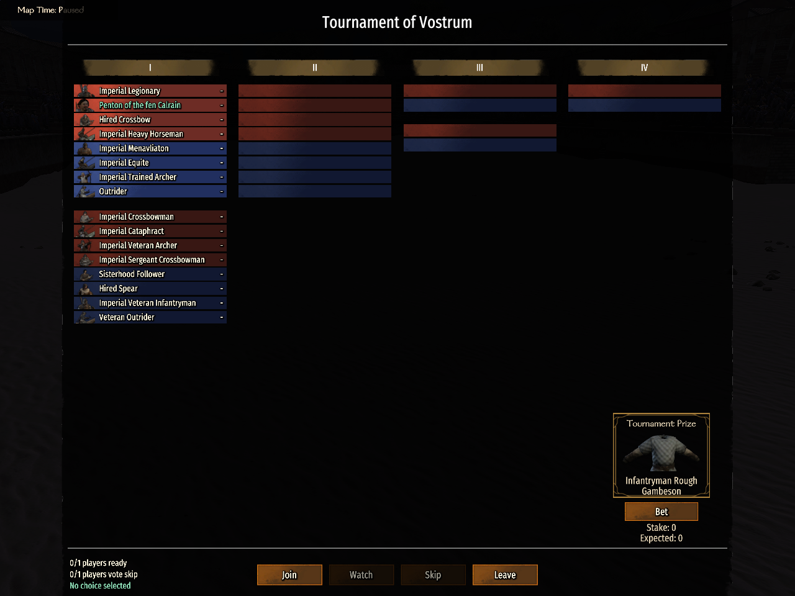
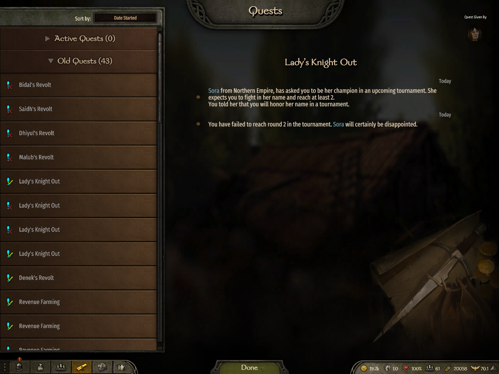
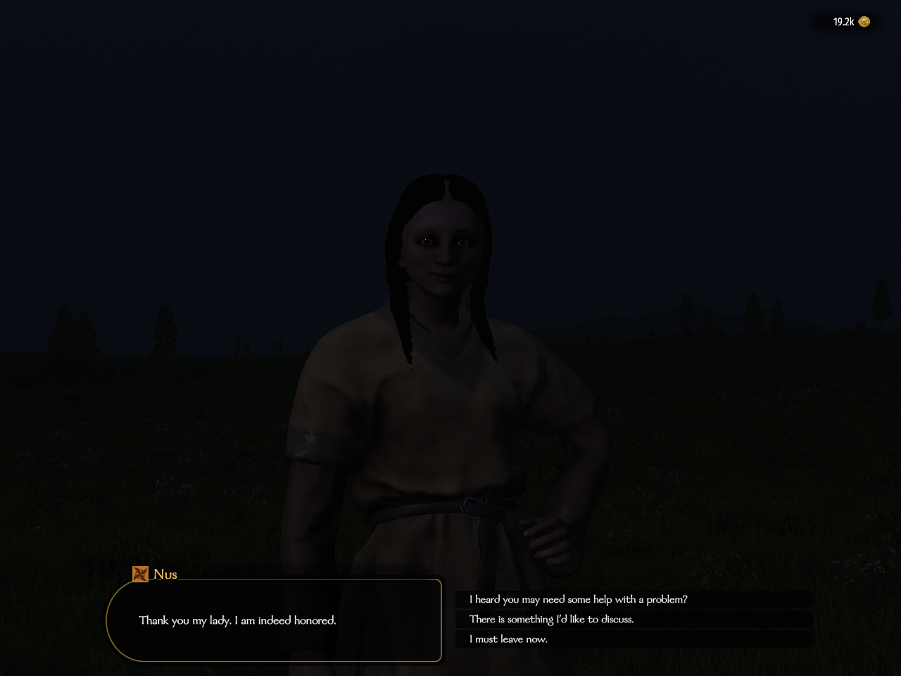
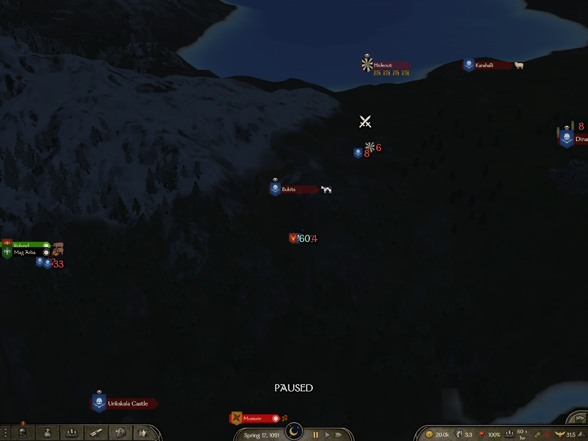
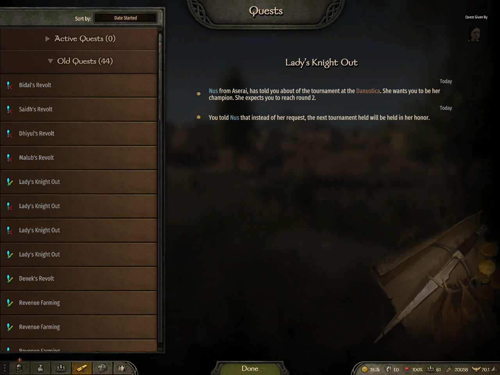
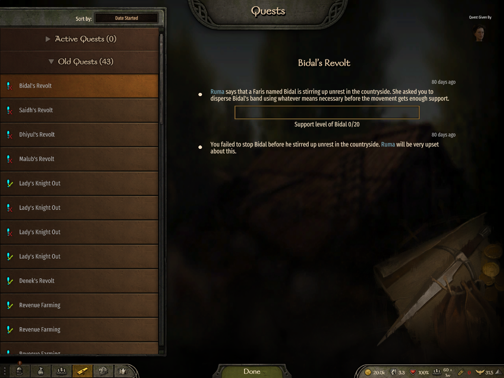

# Lady's Knight Out

## What the issue is

Lady's crime penalty used a private Honor store that conflicted with the shared per-player trait service. A late join during an influence solution could also inherit the owner's completion flag and journal.

## What the evidence shows

The real village action now gives A the crime failure and canonical server Honor-50, while B remains unchanged. A real co-op tournament loss and a pending-solution join also finish with the correct owner journal and unchanged B rewards.

The server and two clients ran e5d2345f99e7. Reward values come from retained game-state reads; the journal images show the actual outcomes. These checks do not exercise a trait-level threshold or preservation of the owner's completed history across reload.

## Village crime

The shared server store ends at Honor-50 for A. B's store remains absent, with the same gold, renown, influence and relation.

## Tournament failure

The server applies one relation penalty and no quest rewards. A's canonical Honor stays-50; B remains unchanged.

## Joining during the influence solution

B loaded the pending issue with its attempted flag false. A then paid18 influence and received7 renown and5 relation; B's values did not change. Older Lady entries remain visible, and retained giver-specific archive reads establish the absence of a completed Nus entry on B.

All owned processes were confirmed absent and the bench released before this report was prepared.
